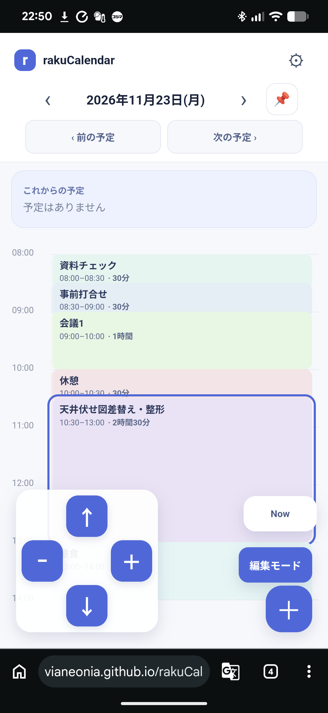
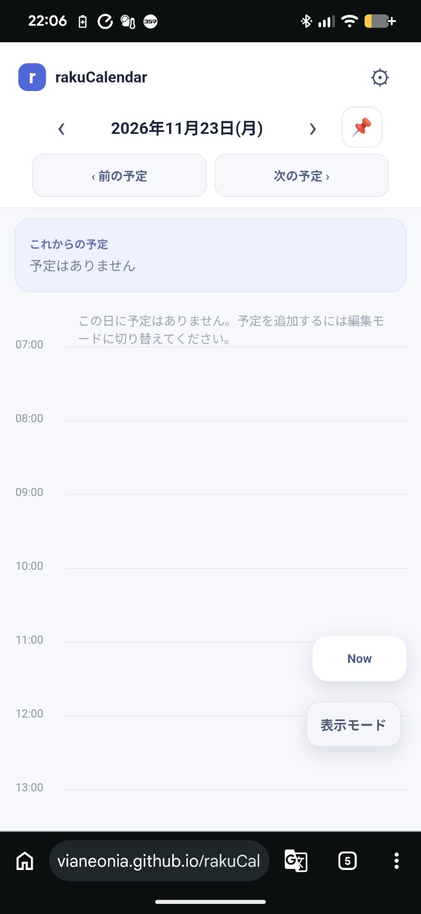
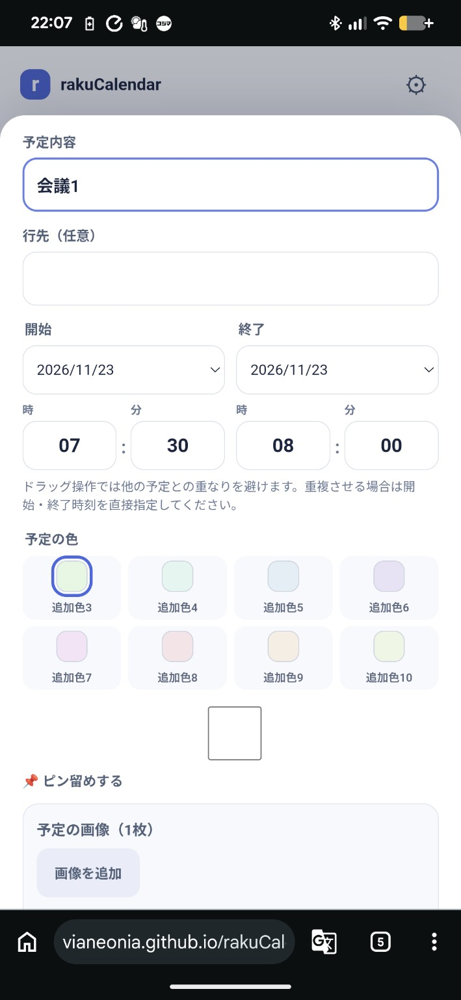
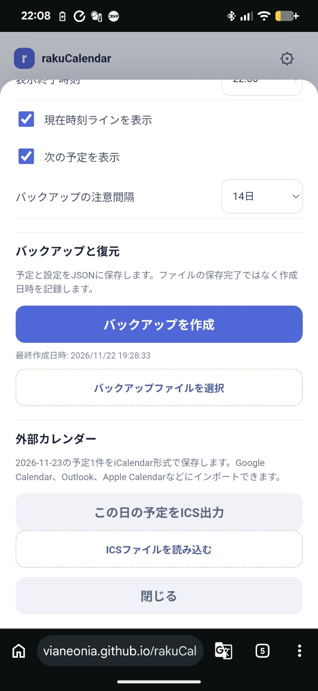

# rakuCalendar

**1日の予定を、時間軸で直感的に管理。**

rakuCalendarは、スマートフォンでの操作に特化した、シンプルな1日単位のカレンダーアプリです。月単位の一覧よりも「今日、何時に何をするか」を重視し、縦方向の時間軸で予定と空き時間を見渡せます。

**[アプリを開く（GitHub Pages）](https://viaNEONIA.github.io/rakuCalendar/)**

## 画面紹介

| 編集モード | 表示モード |
| :---: | :---: |
|  |  |
| **予定の編集** | **設定・データ管理** |
|  |  |

※画面は開発中の実機スクリーンショットです。表示や機能は更新される場合があります。

## 主な機能

### 時間軸で予定を確認

1日の予定を縦方向に表示。予定には開始・終了時刻と所要時間を表示します。予定の重複表示にも対応し、現在時刻のラインや次の予定の案内で、その日の流れを把握できます。

### 閲覧と編集を切り替え

閲覧用の表示モードと、予定を調整する編集モードを切り替えられます。時間軸の移動や拡大・縮小、現在時刻付近に戻る「Now」ボタンを用意しています。

### 予定を登録・編集

予定内容、行先、開始日時、終了日時、メモを管理できます。予定の色分けやピン留めに対応し、予定ごとに画像を1枚添付できます。画像は予定詳細で確認する想定で、QRコードや小さなメモの保存にも使えます。

### データのバックアップと復元

予定と設定をJSON形式でバックアップし、端末変更時などに復元できます。バックアップ作成日時の表示や、バックアップ注意間隔の設定も用意しています。

### 外部カレンダーとの連携

ICS（iCalendar）形式で予定を書き出し、外部カレンダーに取り込めます。ICSファイルの読み込みにも対応しています。各カレンダーでの取り込み結果はサービス側の仕様によって異なります。

### スマートフォン向けPWA

ブラウザで利用できるPWAとして開発。予定データは端末内に保存する設計です。オフライン用のアプリシェルも備えています。

## 使い方

1. [アプリ](https://viaNEONIA.github.io/rakuCalendar/)をスマートフォンのブラウザで開きます。
2. 編集モードで予定を追加し、内容と時間を入力します。
3. 表示モードで1日の流れを確認します。
4. 設定画面から必要に応じてJSONバックアップやICS入出力を行います。

> **データについて**：端末内保存のため、ブラウザデータの削除や機種変更に備えてJSONバックアップを保管してください。バックアップの作成操作と、端末へのファイル保存完了は別です。

## 開発・技術情報

- TypeScript / PWA
- IndexedDBによる端末内データ保存
- 日表示、予定の登録・編集・削除、重複表示
- 時間調整、Undo / Redo
- JSONバックアップ・復元、ICS入出力

### ローカル開発

Node.js 22.12以降（または24以降）とnpmを使用します。

```sh
npm install
npm run dev
npm test
npm run build
```

詳細は[開発引き継ぎ資料](docs/WORK_HANDOFF.md)と[実機確認チェックリスト](docs/DEVICE_TEST_CHECKLIST.md)を参照してください。

## 開発状況

スマートフォン実機での利用を前提に、操作性と画面構成を継続して改善しています。最新の実装状況・検証結果・未解決事項はGitHubのコミットおよびPRを参照してください。

---

**Repository:** [viaNEONIA/rakuCalendar](https://github.com/viaNEONIA/rakuCalendar)
